# Small sample bearing fault diagnosis method based on STFT-SWT-double-stream CNN-SVM, MATLAB code

Preface
Nowadays, everyone is so eager to find innovative points that they're compiling small papers! Many bloggers are launching an endless array of algorithms, with all sorts of combinations that can bewilder. However, sometimes it's not about innovating for the sake of innovation; what truly matters is effectiveness!
This issue introduces a "Small Sample Bearing Fault Diagnosis Method Based on STFT-SWT-Bidirectional CNN-SVM," which first leverages the complementary nature of short-time Fourier transform and synchronously compressed wavelet transform for feature extraction from bearing data. Subsequently, the extracted features are utilized in a bidirectional CNN-SVM model to achieve fault diagnosis. Experiments show that even with a small sample size of only 20 for each type of fault, the proposed model still maintains high accuracy. This paper realizes a method for small sample bearing fault diagnosis.
This method is the author's original creation, do not ask about it, just confirm that no one has ever published it!
STFT: Short-time Fourier Transform (STFT)
SWT: Synchronous Squeeze Wavelet Transform
There are already online documents about the fault diagnosis of STFT-CNN:
[1] Yu Chuanliang, Liang Ruijun, Ran Wenfeng, et al. Gearbox Fault Diagnosis Based on STFT and CNN [J]. Mechanical Manufacturing and Automation, 2022, 51(03): 152-154+195. DOI: 10.19344/j.cnki.issn1671-5276. 2022.03.037.
There are also literatures about the fault diagnosis of SWT-CNN:
[1] Tang Ji Kai, Lu Yixiang, Bai Zhuangzhuang, et al. Synchronous Compression Wavelet Transform and CNN-Based Rolling Bear Fault Diagnosis [J]. Sensors and Microsystems, 2022, 41(06):130-133. DOI: 10.13873/J.1000-9787(2022)06-0130-04.
However, there is no article that has integrated the two.
Synchronous Wavelet Transform (SWT) and Short-Time Fourier Transform (STFT) have certain complementary characteristics in signal processing:
(Complementarity of SWT and STFT:)
①The selective loss problem of SWT refers to the issue that the selection of wavelet basis functions during wavelet transform may lead to the neglect or distortion of some frequency signals. The selective loss problem of SWT can result in the loss or distortion of the signal's frequency information. On the other hand, the Short-Time Fourier Transform (STFT) can to some extent avoid the selective loss problem because it uses a fixed window function to analyze the signal, with the frequency characteristics of the window function corresponding to the signal's frequency characteristics. In STFT, the signal is decomposed into narrow-band signals at both time and frequency, where the frequency information at each time point can be well preserved.
②SWT has the capability of multi-scale analysis, which allows it to analyze signals at different scales, providing more comprehensive frequency information compared to STFT.
This code implements the following functions:
①Implemented synchronous compression wavelet transform (SWT)-CNN fault diagnosis
②Implemented short-time Fourier transform (STFT)-CNN fault diagnosis
③Implemented SWT-STFT-double-stream CNN fault diagnosis
④Implemented SWT-STFT-double-stream CNN-SVM fault diagnosis
⑤For this experiment, the dataset contains 100 samples for each fault category. By selecting training sets as 70%, 30%, and 20% of the total sample volume, we compare the above four methods to verify the advantages of our proposed method in small sample diagnosis.
Model structure diagram is as follows:
Content details:
I. Data Processing
①Process the official downloaded data from Xiu University, with the following steps:
Load a total of 10 types of data, then select DE_time (%DE is driver-side data, FE is fan-side data, BA is acceleration data, choose one of them) for each data.
Set the sliding window w, the number of fault sample points s for each data, and the sample quantity m for each fault type.
After completing all the sliding window data, it is integrated into a single data variable. 
Regarding the processing of data from Xichu University, there was an article that also discussed this topic, which you can refer to: Xichu University Bearing Diagnosis Data Processing with MATLAB Free Code.
The final data is a matrix of 1000*2048, where 1000 is the sample size and 2048 is the number of features. 1000 equals 100*10, indicating 10 types of fault states, and 100 per state, with each state having 100 samples. In the code, it is stored as data_total_1797.mat.
Secondly, SWT and STFT transformations are performed on the data.
SWT transformation results:
STFT transformation results:
Thirdly, results are displayed.
In this model data set, a total of 10 states' data were selected, with each state having 100 samples. Below, for each sample, 70, 30, and 20 samples are chosen as training sets, while the remaining samples are used as test sets, and four methods are compared and validated.
To effectively compare, all CNN parameters in the four methods are set to be consistent!
① When the number of samples in the training set is 70, i.e., 700 samples as the training set, and the remaining 300 as the test set:
Synchronous Compression Wavelet Transform (SWT)-CNN diagnostic results:
Short-time Fourier Transform (STFT)-CNN diagnostic results:
SWT-STFT-Bidirectional CNN diagnostic results:
SWT-STFT-Bidirectional CNN-SVM diagnostic results:
Here, it can be observed that when the sample size is 70%, the four methods perform equally well, without significant differences. They can achieve a relatively good diagnostic effect.
② When the number of samples in the training set is 20, i.e., 200 samples as the training set, and the remaining 800 as the test set:
Synchronous Compression Wavelet Transform (SWT)-CNN diagnostic results:
Short-time Fourier Transform (STFT)-CNN diagnostic results:
SWT-STFT-Bidirectional CNN diagnostic results:
SWT-STFT-Bidirectional CNN-SVM diagnostic results:
The SWT-STFT-Bidirectional CNN-SVM model proposed in this paper achieves high accuracy when trained with small sample data, reaching over 97%. To demonstrate the non-randomness of these results, the author conducted 10 experiments on the mentioned SWT-STFT-Bidirectional CNN-SVM model, with accuracies consistently above 90%, averaging over 95%, and achieving the highest accuracy of 98.875%. This clearly outperforms the other four models.
When writing your paper, you can also conduct multiple experiments on the aforementioned model to statistically analyze the average results, highlighting its superiority. The details are not elaborated here.
The parallel CNN network structure proposed in this issue is consistent with the diagrammatic structure mentioned earlier.
Each folder contains a "README.txt" file explaining the program, which you should carefully read before running to better understand the program. Follow the steps one by one.
I commit that all experiments mentioned above are genuine and valid!
Code directory

## Images

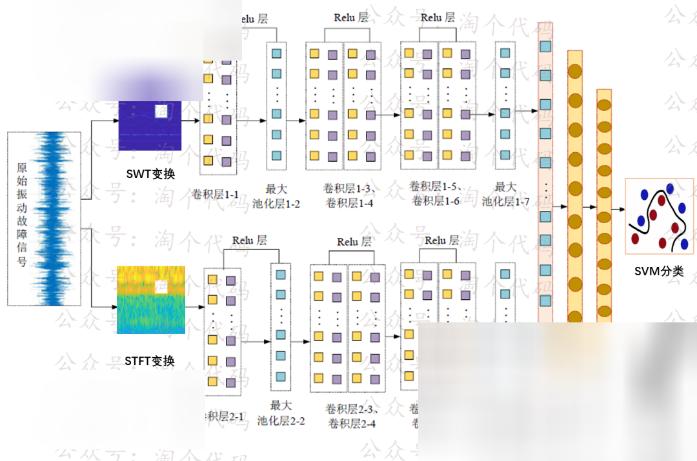
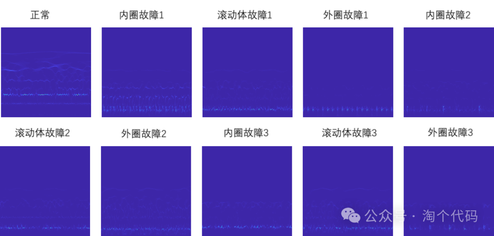
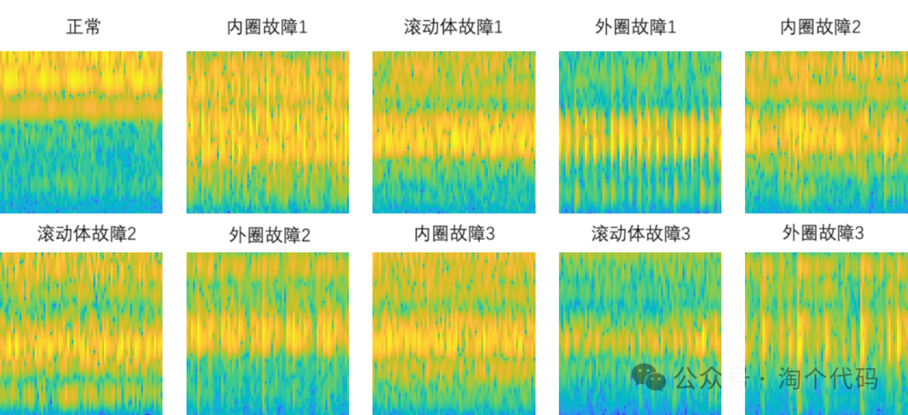
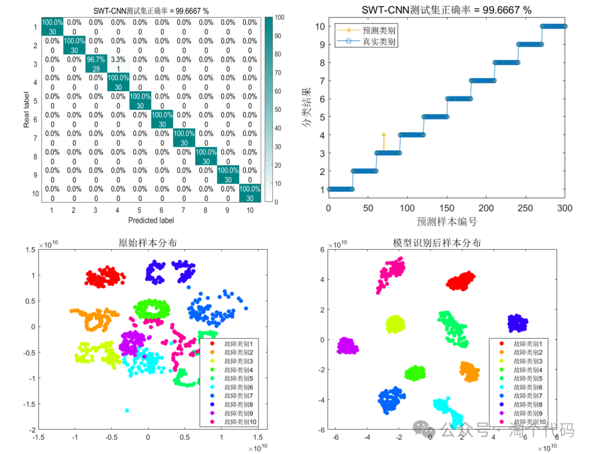
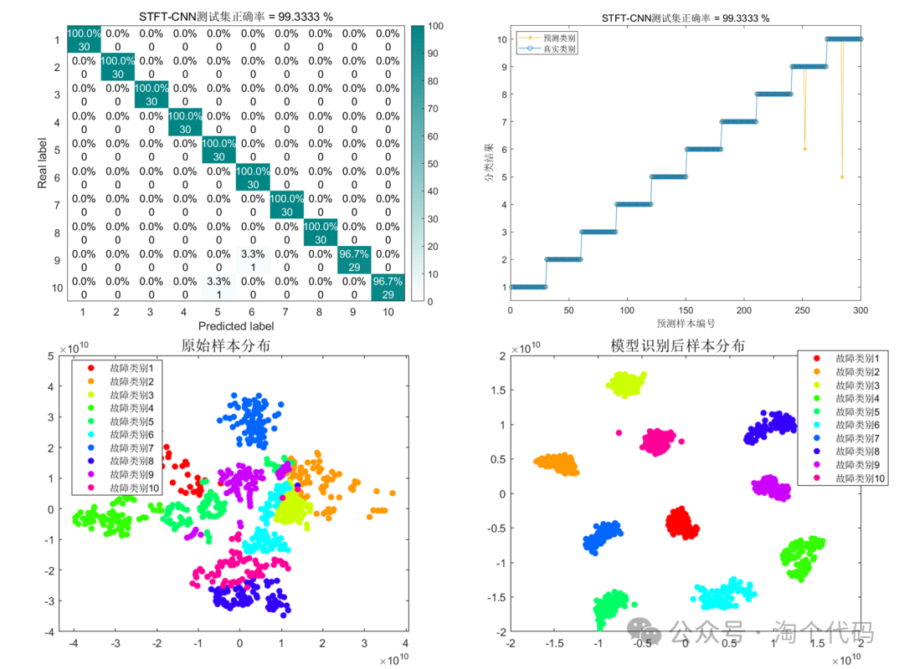
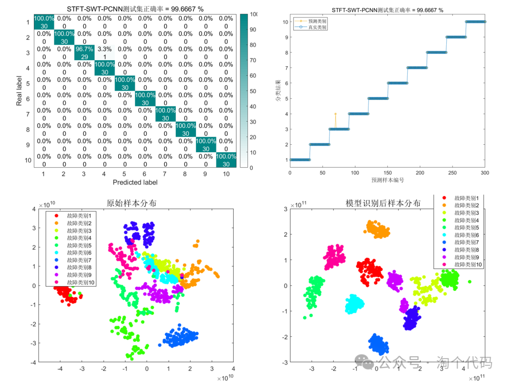
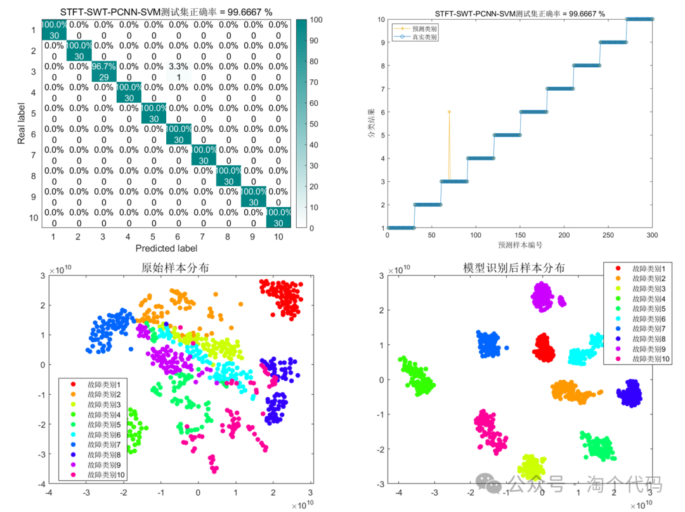
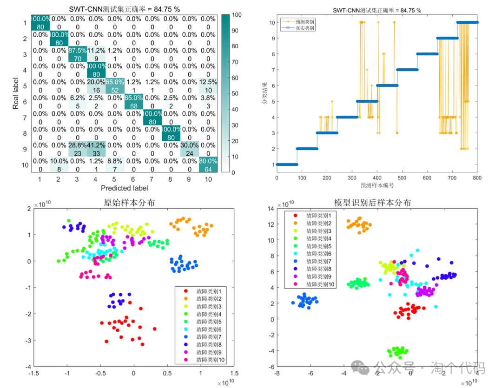
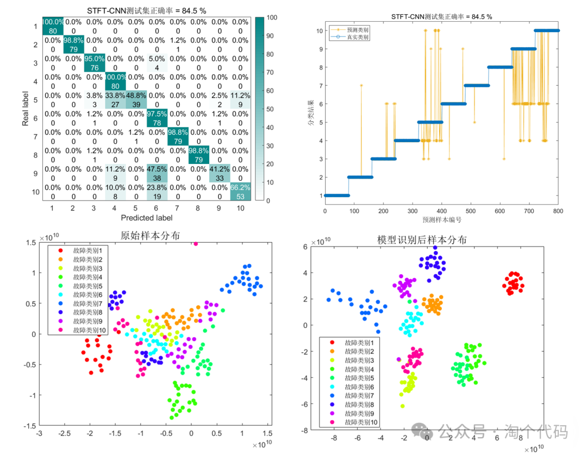
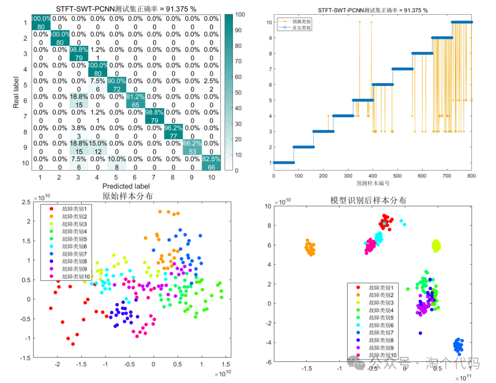
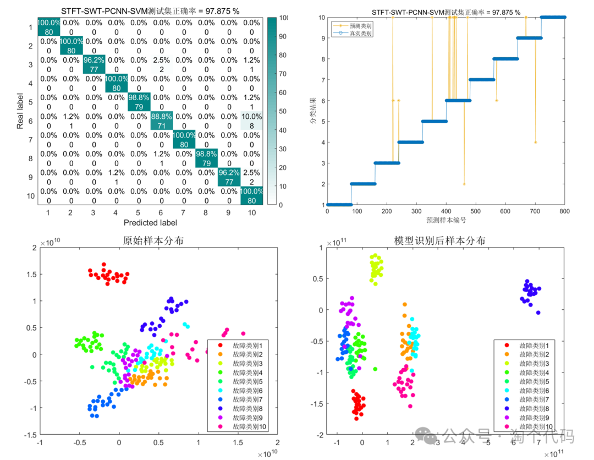
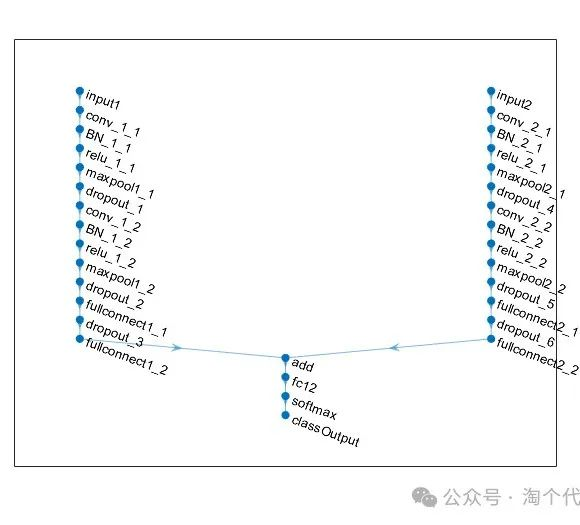
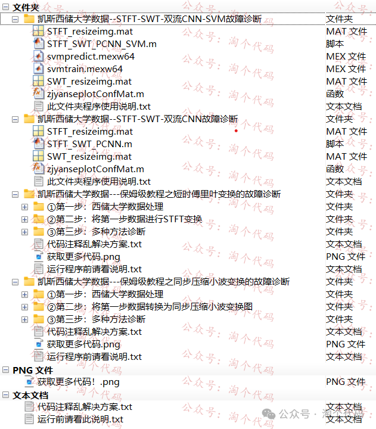

<!-- PAYMENT_BLOCK -->

## Get this dataset

- Payment link (Stripe): [Buy now](https://buy.stripe.com/3cs8yP7sY87d0vu9AB)
- Payment QR code: 

<!-- /PAYMENT_BLOCK -->
